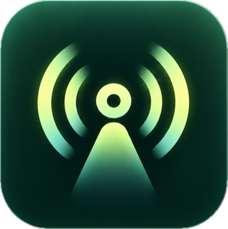
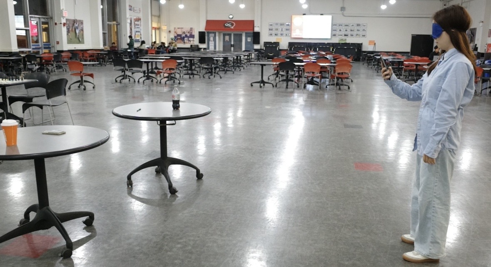
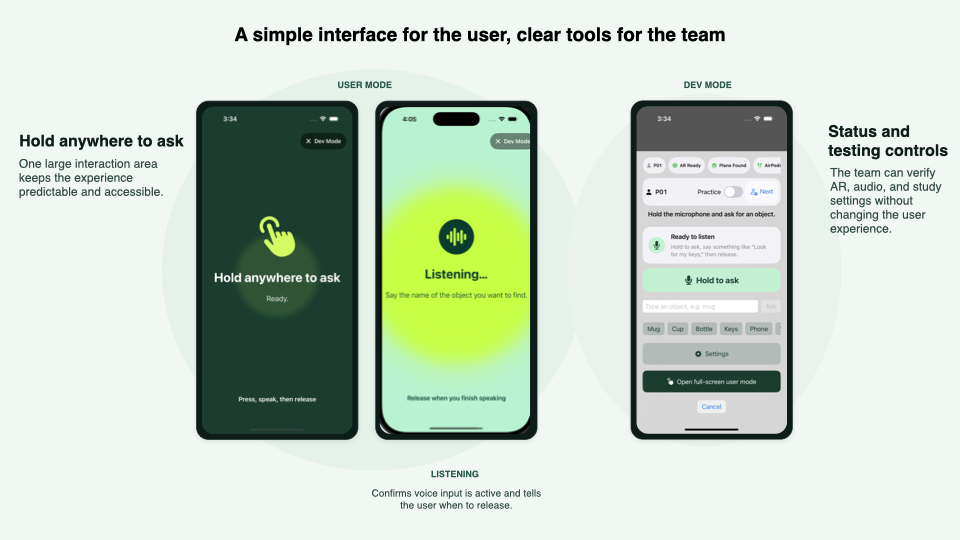
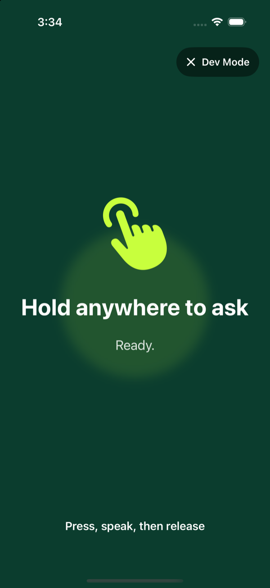
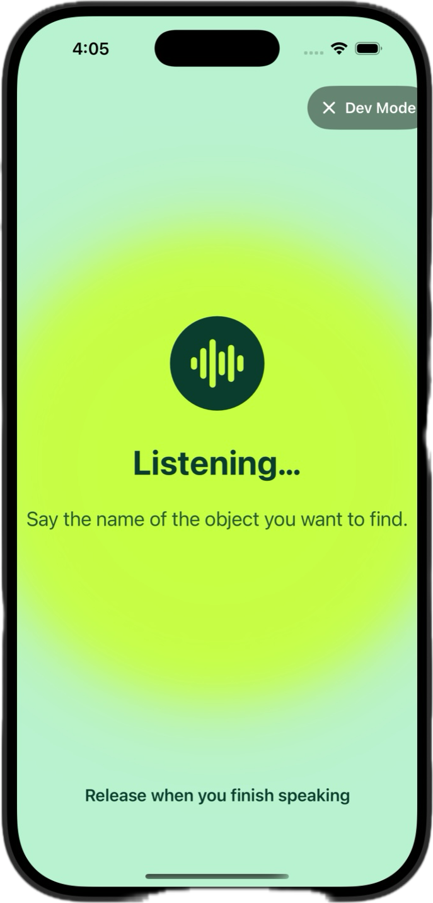
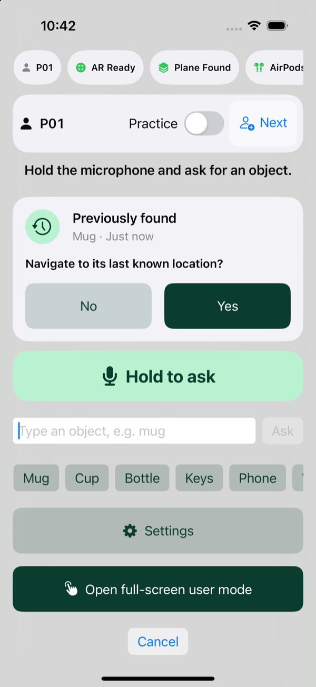
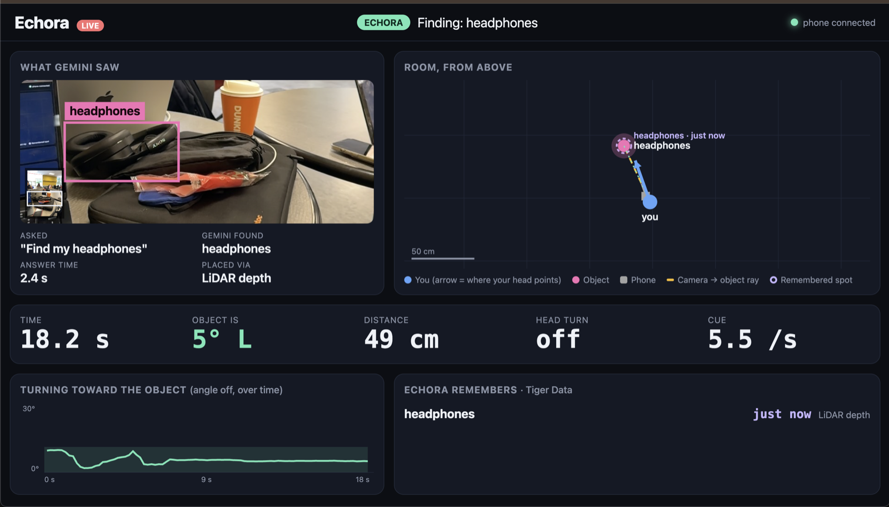
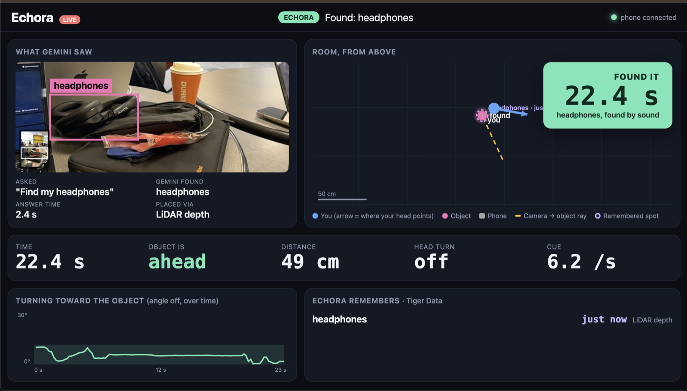
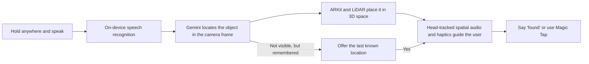
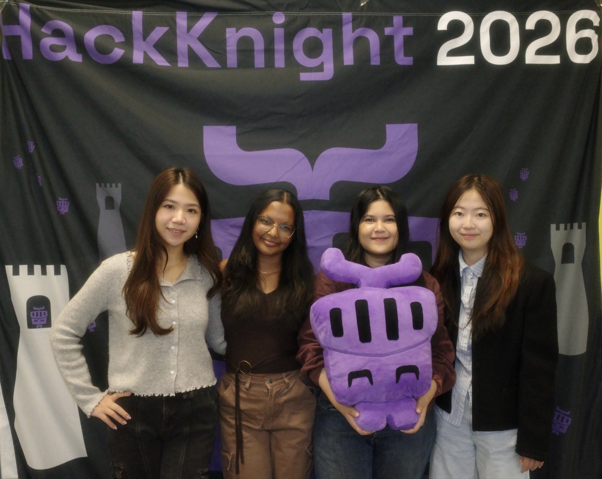

<p align="center">
  
</p>

<h1 align="center">Echora</h1>

<p align="center"><strong>Find your way through sound.</strong></p>

<p align="center">
  An accessible iOS app that helps blind and low-vision people find everyday objects<br>
  through voice, spatial audio, and haptic guidance.
</p>

<p align="center">
  <a href="https://devpost.com/software/echora"><strong>Devpost</strong></a>
  ·
  <a href="https://www.youtube.com/watch?v=1o1XggFS4XU"><strong>Demo video</strong></a>
  ·
  <a href="https://hear-echora.us/"><strong>Live dashboard</strong></a>
</p>

<p align="center">
  
  
  
  
  
  
  <a href="https://github.com/tisya05/hack-knight-gwh/actions/workflows/ci.yml"></a>
</p>

<p align="center"><em>Built in 48 hours at Hack Knight 2026, Queens College.</em></p>



## Demo

<p align="center">
  <a href="https://www.youtube.com/watch?v=1o1XggFS4XU">
    
  </a>
</p>

<p align="center"><a href="https://www.youtube.com/watch?v=1o1XggFS4XU"><strong>Watch Echora in action →</strong></a></p>

## The problem

Finding a misplaced mug, phone, or pair of headphones is a visual task most people take for granted. Existing tools can identify what a camera sees, but they often stop at a spoken description such as “the mug is on the left.” That still leaves the user translating words into movement.

Echora turns the object itself into the destination. The user asks for an item, and a spatial sound plays from its real-world direction. As the user turns and moves, the sound and vibration guide them toward it.

## What Echora does

1. **Ask naturally.** Hold anywhere on the screen and say the name of an object.
2. **Locate it with AI.** Gemini analyzes the camera image while ARKit and LiDAR place the result in 3D space.
3. **Follow the sound.** AirPods head tracking keeps the audio cue anchored to the object as the user moves.
4. **Confirm without hunting for a button.** Say “found” or use VoiceOver Magic Tap.
5. **Return to remembered objects.** If an item is no longer visible, Echora can offer its last known location without making another AI request.

## Designed around the user



<table>
  <tr>
    <td width="50%" align="center"><strong>Ready</strong></td>
    <td width="50%" align="center"><strong>Listening</strong></td>
  </tr>
  <tr>
    <td></td>
    <td></td>
  </tr>
  <tr>
    <td>One large interaction area keeps the experience predictable: press, speak, then release.</td>
    <td>A bright state change, haptic feedback, and a gentle earcon confirm that voice input is active.</td>
  </tr>
</table>

### Echora remembers

<table>
  <tr>
    <td width="42%"></td>
    <td>
      <h3>Find it again—without another AI call</h3>
      <p>When Gemini locates an object, Echora remembers that position for the current AR session. If the object later moves out of view, the app offers to guide the user back to its last known location.</p>
      <p>The user can answer by voice. The visible Yes and No controls are available in the separate operator view for testing.</p>
    </td>
  </tr>
</table>

### A live view for the team

The companion dashboard makes an invisible audio experience understandable to judges and testers. It shows what Gemini saw, the object and user positions, head direction, distance, cue rate, elapsed time, and remembered sightings.

<table>
  <tr>
    <td width="50%" align="center"><strong>Finding</strong></td>
    <td width="50%" align="center"><strong>Found</strong></td>
  </tr>
  <tr>
    <td></td>
    <td></td>
  </tr>
</table>

Explore the deployed dashboard at **[hear-echora.us](https://hear-echora.us/)**.

## How it works



The directional guidance itself uses a nonverbal spatial cue—not spoken left/right instructions. Short, prerecorded ElevenLabs voice lines are reserved for status updates such as “previously found” or “navigating.”

## Accessibility first

| Design decision | Why it matters |
|---|---|
| Full-screen hold target | No small button needs to be found visually. |
| Spatial audio plus haptics | Direction and progress are available through more than one sense. |
| VoiceOver labels and Magic Tap | Standard iOS accessibility gestures remain available throughout a search. |
| Nonverbal guidance cue | The user can react to direction immediately instead of interpreting repeated instructions. |
| Separate operator mode | Debug and study controls never crowd the primary user experience. |
| Automatic AR setup | There is no calibration button for the user to locate. |

## Tech stack

| Layer | Technology | Role |
|---|---|---|
| iOS experience | Swift, SwiftUI, VoiceOver | Accessible user and operator interfaces |
| Perception | Gemini, ARKit, LiDAR | Object detection and real-world placement |
| Guidance | AVAudioEngine, Core Motion, AirPods | Anchored spatial audio and head tracking |
| Voice and feedback | Speech framework, ElevenLabs, Core Haptics | Requests, status prompts, earcons, and vibration |
| Backend | FastAPI, Pydantic | Telemetry and sighting APIs |
| Data | Tiger Data / TimescaleDB | Search rounds, trajectories, and remembered sightings |
| Dashboard | Python relay, HTML, CSS, JavaScript | Live visualization for demos and testing |

## Project structure

```text
hack-knight-gwh/
├── ios/Echora/          # SwiftUI app, AR perception, audio, voice, and telemetry
├── ios/EchoraTests/     # iOS unit and integration tests
├── backend/             # FastAPI service backed by Tiger Data
├── live-dashboard/      # Real-time laptop dashboard and phone relay
├── dashboard/           # Study results dashboard
├── docs/CONTRACT.md     # Shared architecture and feature contract
└── project.yml          # XcodeGen project definition
```

The shared architecture, module ownership, and feature contract live in [`docs/CONTRACT.md`](docs/CONTRACT.md).

## Run locally

### Requirements

- macOS with Xcode 16.4 or later
- iOS 17 or later
- [XcodeGen](https://github.com/yonaskolb/XcodeGen)
- An Apple ID for local signing
- A physical iPhone for camera, ARKit, LiDAR, and AirPods testing

### One-time setup

1. Install Xcode, launch it once, and accept its license.
2. Install XcodeGen:

   ```sh
   brew install xcodegen
   ```

3. Create your ignored local signing configuration:

   ```sh
   cp ios/Config/Local.xcconfig.example ios/Config/Local.xcconfig
   ```

4. Add your development team ID and a unique bundle identifier suffix to `ios/Config/Local.xcconfig`.
5. Sign in with your own Apple ID in **Xcode → Settings → Accounts**.

Never share or commit Apple IDs, certificates, provisioning profiles, `Local.xcconfig`, `Secrets.xcconfig`, or backend secrets.

### Build and run

```sh
xcodegen generate
xcodebuild -scheme Echora -destination 'generic/platform=iOS Simulator' build
open Echora.xcodeproj
```

`Echora.xcodeproj` is generated and intentionally ignored by Git. Make project changes in `project.yml`, then regenerate the project.

By default, the app runs with mock services, so the interface can be explored in the simulator without spending API requests.

To run on an iPhone:

1. Enable **Developer Mode**, then connect and unlock the phone.
2. Accept the **Trust This Computer** prompt.
3. Select the **Echora** target in Xcode and open **Signing & Capabilities**.
4. Enable **Automatically manage signing** and choose your Personal Team.
5. Select the phone as the run destination and press **Command-R**.
6. If iOS asks, trust the developer app under **Settings → General → VPN & Device Management**, then run again.

<details>
<summary><strong>Enable real services</strong></summary>

Choose which services are real in the ignored `ios/Config/Local.xcconfig`:

```text
ECHORA_REAL_SERVICES = perception locator headTracking audio voice telemetry
```

Rebuild after changing this value. Real perception requires a physical phone; unavailable services continue to use their mock implementation. A one-off service can also be overridden with an Xcode launch argument such as `-flag.mockPerception NO`.

</details>

<details>
<summary><strong>Add a Gemini API key</strong></summary>

Create the ignored `ios/Config/Secrets.xcconfig` and add:

```text
GEMINI_API_KEY = your-key-here
```

Get a key from [Google AI Studio](https://aistudio.google.com/). Do not use real Gemini requests in unit tests or loops; the repository includes mocks for local development.

The free tier is limited, so leave `locator` out of `ECHORA_REAL_SERVICES` unless you are intentionally testing Gemini. Each Ask uses one request—or two if the primary model is slow and the app races its backup. Check current usage and limits in Google AI Studio.

</details>

<details>
<summary><strong>Debug switches</strong></summary>

The Settings screen exposes these values from `UserDefaults`; they can also be supplied as launch arguments such as `-debug.showMarkers NO`.

| Key | Default | Effect |
|---|---|---|
| `debug.showMarkers` | on | Shows target markers, camera diagnostics, Test mode, and Stop camera. Turn it off for demos. |
| `debug.disableLiDAR` | off | Tests the non-LiDAR table-surface placement path. |
| `flag.mockPerception`, `flag.mockLocator`, `flag.mockHeadTracking`, `flag.mockAudio`, `flag.mockVoice`, `flag.mockTelemetry` | local config | Overrides one service between its mock and real implementation. |

In camera **Test mode**, a tap runs both placement paths: red is the direct tap, blue is LiDAR, and green is non-LiDAR.

</details>

<details>
<summary><strong>Run the live dashboard locally</strong></summary>

```sh
python3 live-dashboard/server.py
```

Set `ECHORA_LIVE_URL` in `ios/Config/Local.xcconfig`. See [`live-dashboard/README.md`](live-dashboard/README.md) for the full setup.

</details>

## Testing

Before opening a pull request:

```sh
git fetch origin
git merge origin/main
xcodegen generate
xcodebuild -scheme Echora -destination 'generic/platform=iOS Simulator' build
xcodebuild -scheme Echora -destination 'platform=iOS Simulator,name=<installed iPhone>' test
```

Camera, LiDAR, head tracking, and spatial audio still need a physical-device smoke test. Unit tests use mocks and must not call Gemini or the deployed backend.

## What's next

- Remember objects across sessions and rooms instead of only one AR session
- Add an optional room scan for faster repeat searches
- Test with blind and low-vision participants beyond informal hackathon demos
- Move external API calls behind production-grade authentication and privacy controls
- Expand the object-finding experience beyond iOS

## Team

<p align="center">
  
</p>

<p align="center">
  <em>From left: Qimin Wu, Tisya Singh, Miskatul Moon, and Seoyeon Cho.</em>
</p>

| Member | Focus |
|---|---|
| [Qimin Wu](https://github.com/qimin5) · `qimin5` | iOS UI/UX, accessibility, branding, and sound design |
| [Miskatul Moon](https://github.com/miskatulmoon) · `miskatulmoon` | FastAPI, Tiger Data, telemetry, and dashboard |
| [Tisya Singh](https://github.com/tisya05) · `tisya05` | Gemini perception, ARKit, and integration |
| [Seoyeon Cho](https://github.com/aschlierca) · `aschlierca` | Spatial audio, head tracking, and voice |

## Built with

Echora uses [Google Gemini](https://ai.google.dev/) for visual object location, [ElevenLabs](https://elevenlabs.io/) for prerecorded status prompts, and [Tiger Data](https://www.tigerdata.com/) for time-series telemetry and object sightings.

This is a hackathon prototype and not a clinical mobility aid. Development testing should be performed in a controlled, obstacle-free environment.
